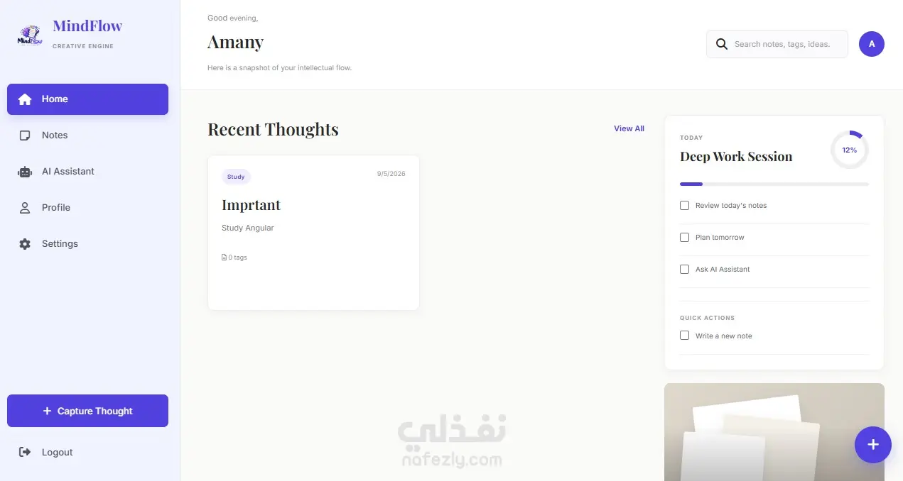

<div align="center">


<br/>


<br/><br/>

<a href="https://amany-portifolio.vercel.app/">
  
</a>
<a href="https://www.linkedin.com/in/amanymsadky/">
  
</a>
<a href="https://nafezly.com/u/amany_mohammed">
  
</a>
<a href="https://github.com/AmanyMohamed-eng">
  
</a>

<br/><br/>


</div>

---

## 👩‍💻 About Me

I'm a **Full Stack Developer** interested in building modern, responsive, and user-focused web applications.

I enjoy working across the development process, from designing intuitive frontend interfaces to building backend services and working with databases.

- 💻 Focused on Full Stack Web Development.
- ⚙️ Currently strengthening my Backend Development skills.
- 🌱 Exploring Node.js, Express.js, MongoDB, and API development.
- 🎨 Interested in clean UI, responsive design, and maintainable code.
- 🤝 Open to internships, freelance projects, and collaboration.

```javascript
const amany = {
  role: "Full Stack Developer",
  location: "Egypt",
  interests: [
    "Backend Development",
    "Full Stack Applications",
    "Database Design",
    "Problem Solving"
  ],
  currentlyLearning: [
    "Node.js",
    "Express.js",
    "MongoDB",
    "REST APIs"
  ],
  goal: "Build reliable applications that solve real problems"
};
```

---

## 🛠️ Tech Stack

<div align="center">

### Frontend Development


### Backend Development


### Programming & Computer Science


### Tools & Workflow


</div>

| Category | Technologies |
|---|---|
| Languages | JavaScript, TypeScript, C++, C# |
| Frontend | HTML5, CSS3, React, Angular, Bootstrap, Tailwind CSS |
| Backend | Node.js, Express.js, REST APIs |
| Database | MongoDB, SQL Fundamentals |
| Concepts | OOP, Data Structures, Problem Solving |
| Tools | Git, GitHub, VS Code, Postman |

---

## 🚀 Featured Projects

<div align="center">

<table>
<tr>
<td width="50%" valign="top">

### 🧠 MindFlow

<a href="https://github.com/AmanyMohamed-eng/MindFlow">
  
</a>

A productivity management application for organizing notes, tasks, and daily activities.

**Highlights:**
- Dashboard and productivity overview
- Notes and task management
- Calendar and analytics
- Dark and light themes

[View Repository](https://github.com/AmanyMohamed-eng/MindFlow) · [Live Demo](https://amanymohamed-eng.github.io/MindFlow/)

</td>
<td width="50%" valign="top">

### 🤖 Mini AI

<a href="https://github.com/AmanyMohamed-eng/mini-ai">
  
</a>

An AI-related project exploring practical application development.

**Highlights:**
- AI-focused application
- Interactive user experience
- Practical implementation of AI concepts

[View Repository](https://github.com/AmanyMohamed-eng/mini-ai)

</td>
</tr>
<tr>
<td width="50%" valign="top">

### 🌍 Minia Travel

<a href="https://amanymohamed-eng.github.io/Minia_travel/">
  
</a>

A travel website showcasing destinations and tourism-related content in Minia.

**Highlights:**
- Travel-focused website
- Information about Minia
- Responsive web experience

[Live Demo](https://amanymohamed-eng.github.io/Minia_travel/)

</td>
<td width="50%" valign="top">

### 🍽️ Foody

<a href="https://github.com/Craft-Coders-Team/Foody/tree/sections-topReceipts">
  
</a>

A collaborative food-related web project developed as part of a team.

**Highlights:**
- Food and recipe-focused content
- Collaborative team development
- Dedicated project sections

[View Team Repository](https://github.com/Craft-Coders-Team/Foody/tree/sections-topReceipts)

</td>
</tr>
<tr>
<td width="50%" valign="top">

### 🏡 Nestora

<a href="https://github.com/AmanyMohamed-eng/NESTORA">
  
</a>

A furniture and home decor website built with Angular, featuring a clean and modern frontend experience.

**Highlights:**
- Furniture and home decor categories
- Product-focused browsing experience
- Responsive Angular frontend

[View Repository](https://github.com/AmanyMohamed-eng/NESTORA)

</td>
<td width="50%" valign="top">

</td>
</tr>
</table>

</div>

---

## 📈 Contribution Activity

<div align="center">


<br/><br/>


<br/><br/>

<picture>
  <source
    media="(prefers-color-scheme: dark)"
    srcset="https://raw.githubusercontent.com/AmanyMohamed-eng/AmanyMohamed-eng/output/github-contribution-grid-snake-dark.svg"
  />
  <source
    media="(prefers-color-scheme: light)"
    srcset="https://raw.githubusercontent.com/AmanyMohamed-eng/AmanyMohamed-eng/output/github-contribution-grid-snake.svg"
  />
  
</picture>

</div>

---

## 📊 GitHub Statistics

<div align="center">


<br/><br/>


</div>

---

## 🎓 Education & Courses

- **Minia University** — Faculty of Computers and Information, Computer Science.
- **ITI** — React Development.
- **NTI** — AI Full Stack Development Track  
  Topics included Node.js, Express.js, MongoDB, and Angular.

---

## Competitive Programming & Problem Solving

I regularly practice problem-solving to improve my algorithmic thinking and coding skills.

<div align="center">

  <a href="https://codeforces.com/profile/Amany_Mohamed22">
    
  </a>

  <br/><br/>

  <a href="https://codeforces.com/profile/Amany_Mohamed22">
    
  </a>

</div>

### Problem-Solving Focus

- Data Structures & Algorithms
- Arrays & Strings
- Sorting & Searching
- Binary Search
- Mathematics
- Problem Analysis
- Time & Space Complexity

---

---

## 🌐 Find Me Around the Web

<div align="center">

<a href="https://amany-portifolio.vercel.app/">
  
</a>
<a href="https://www.linkedin.com/in/amanymsadky/">
  
</a>
<a href="https://nafezly.com/u/amany_mohammed">
  
</a>
<a href="https://nafezly.com/my/portfolios">
  
</a>
<a href="https://github.com/AmanyMohamed-eng">
  
</a>

</div>

---

<div align="center">

### ✨ Thanks for visiting my profile!

*Always learning, building, and improving.*


</div>
